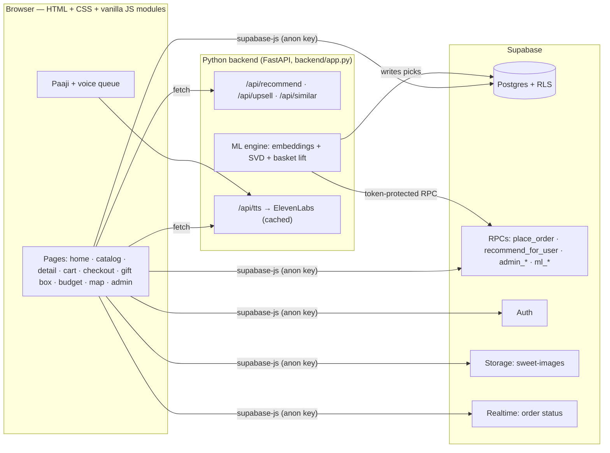

# 🪔 Swaad Sujhaav — *Har mann ki mithai, ek sujhaav door*

A festive mithai shop for **Muzaffarnagar** with a talking Punjabi halwai mascot, **Paaji**,
a free local machine-learning recommendation engine, and a shop designed around one idea:

> **"Ek banda ek cheez kharidne aaya tha… teen le gaya."**
> *(Someone came in for one thing and left with three.)*

---

## ✨ What makes it different

| Feature | What it does |
|---|---|
| 🧔🏽 **Talking Paaji** | Original animated SVG halwai (idle, wave, talk, point, think, celebrate, bhangra). Every line shows in a speech bubble **and** is spoken in a human voice (ElevenLabs "George", cached), with a free browser-voice fallback. He never talks over himself. |
| ✍️ **Original shayari** | 100 original shayari (Devanagari + Hinglish + English). Paaji recites the one for whatever you add. |
| 🎯 **"Ye bhi le jao, poore Muzaffarnagar mein nayi hai!"** | After every add, Paaji points at a perfect next sweet (new arrivals first) with a one-tap add. |
| 🍬 **Mix & Save** | 3 different sweets = 5% off, 5+ = 10% off — applied **on the server**. Live progress bar + Paaji nudges. |
| 🍬🍬🍬 **Trio bar** | After an add, a slim bar offers two perfect partners: *"Add both · 5% off unlocked"*. |
| ✨ **Free taste** | Orders with 3+ kinds get a free piece of a new arrival — introduces new sweets. |
| 🔥 **Honest social proof** | "14 orders this month" from real orders only. Never invented. |
| 🎁 **Gift Box Builder** | 4/9/16 pieces, tap or drag sweets in, "Paaji, bharo!" fills empty slots, ribbon + message card. Server-priced. |
| 💰 **Budget Mode** | "₹500 for 10 guests" → the best mix of hand-out-able sweets within budget. |
| 🗺️ **Mithai World Map** | Hex-tile maps of India and the world; tap a region to taste it. |
| 🧠 **Real ML** | Sentence-transformer embeddings + collaborative filtering (SVD) + basket lift, every pick explained ("Because you loved Rasgulla"). |
| 📝 **Taste Quiz** | 5 playful questions after sign-up; Paaji reacts to each answer. |
| 😊 **Mood picker** | Celebrating / Feeling light / Guests coming / Late-night craving re-ranks the home page. |
| 🎙️ **Voice search & commands** | "Paaji, do kilo kaju katli daal do" → added to cart. |
| 🪔 **Deepawali everything** | Live countdown to Lakshmi Puja (8 Nov 2026, 5:30 PM), Deepawali Night theme (auto near Deepawali evenings), toran, diya cursor trail, fireworks on order. |
| 🛠️ **Admin panel** | Dashboard, live orders, inventory & stock per weight, catalog editor with photo upload, **CSV import**, customers & their taste choices, Paaji lines & shayari editor, one-click model retraining. |

Plus: 242 sweets (174 Indian, 68 world) with real photos (Wikimedia Commons, credited), Hindi/English
toggle, guest cart merged on login, live order tracking (Supabase Realtime), "Your usual?" one-tap
reorder, favourites, sugar-free/vegan/Jain/gluten-free filters, reduced-motion support, mobile-first.

---

## 🏗️ Architecture



- **The shop works even when Python is off**: the ML job saves its results to Supabase
  (`sweet_similar`, `user_recos`), and SQL functions provide a full fallback.
- **No service-role key in the app.** The ML engine authenticates with a random `ML_TOKEN`; only its
  SHA-256 hash lives in a private schema. Prices, discounts and stock are always computed in Postgres.

```
swaad-sujhav/
├── index.html              # app shell (entry screen, header, drawer, Paaji, icon sprite)
├── css/                    # tokens, base, components, pages, paaji, festive
├── js/                     # main (router), catalog, cart, deals, recommend, paaji, voice, lines, festive, …
│   └── pages/              # home, catalog, detail, profile, checkout, order, giftbox, budget, worldmap, admin
├── backend/                # FastAPI app + ML engine + TTS proxy
├── seed/                   # catalog data, shayari, seed generator (photos via Wikimedia API)
├── supabase/
│   ├── schema.sql          # tables, RLS, triggers, all functions
│   ├── seed.sql            # generated: 242 sweets, variants+stock, shayari, demo customers & orders
│   └── templates/          # CSV templates for the admin importer
└── docs/                   # SPEC_ADDENDUM.md, voice samples
```

---

## 🚀 Setup

1. **Supabase**: create a project, then in the SQL editor run, in order:
   1. `supabase/schema.sql`
   2. `supabase/seed.sql` (or the files in `supabase/seed_parts/` one by one)
2. **Frontend config**: copy `js/config.example.js` → `js/config.js` and fill in the project URL and the
   **anon/publishable** key (Project Settings → API). Never put the service-role key here.
3. **Backend** (recommendations + Paaji's studio voice):
   ```bash
   cd backend
   python -m venv .venv
   .venv\Scripts\pip install -r requirements.txt      # macOS/Linux: .venv/bin/pip
   copy .env.example .env                              # then fill it in
   .venv\Scripts\python app.py                          # → http://localhost:8130
   ```
   In `.env`: `SUPABASE_URL`, `SUPABASE_ANON_KEY`, a random `ML_TOKEN`
   (e.g. `python -c "import secrets;print(secrets.token_urlsafe(32))"`), and optionally
   `ELEVENLABS_API_KEY` + `ELEVENLABS_VOICE_ID`. Then register the token's hash once in the SQL editor:
   ```sql
   insert into private.app_secrets (name, sha256_hex)
   values ('ml_token', encode(extensions.digest('<your ML_TOKEN>', 'sha256'), 'hex'))
   on conflict (name) do update set sha256_hex = excluded.sha256_hex, updated_at = now();
   ```
   The model trains on startup and every `RETRAIN_EVERY_MINUTES` (default 60).
4. **Frontend-only hosting** (Netlify/Vercel): deploy the folder as a static site (exclude `backend/`,
   `seed/`, `supabase/seed*`), and set `API_BASE` in `js/config.js` to your backend URL. The shop still
   works without the backend (SQL fallbacks + saved ML picks + browser voice).

> ⚠️ Only `css/`, `js/`, `assets/`, `index.html` and `supabase/templates/` are public. `backend/app.py`
> serves exactly those — never the project root (it contains `backend/.env`).

### Make yourself an admin
Sign up in the app, then in the SQL editor:
```sql
update public.profiles set is_admin = true
where id = (select id from auth.users where email = 'you@example.com');
```
Open **Profile → 🛠️ Admin panel** (or `#/admin`). Admins can promote others from the Customers tab.

### Demo accounts (test data only)
`priya.demo@`, `rohan.demo@`, `meera.demo@` (sugar-free), `arjun.demo@` (world desserts),
`simran.demo@`, `kavya.demo@` and `admin@` — all `@swaadsujhav.test`, password `SwaadDemo#2026`
(defined in `seed/build_seed.py`). Delete or change them before going live.

---

## 🧠 How recommendations work (in simple words)

Paaji looks at every sweet in four ways and mixes the scores:

1. **What it *is*** — a small free AI model (sentence-transformers) reads each sweet's name, story,
   ingredients and region and turns it into numbers, so it knows *Rasmalai* is close to *Rasgulla* and
   *Baklava* is close to *Turkish Delight*. ("More dishes like this")
2. **Who buys it** — if people who love *Tiramisu* also love *Kunafa*, you might too
   (collaborative filtering with SVD).
3. **What goes together** — sweets that land in the same order ("Goes great with").
4. **You** — your taste-quiz answers, favourites and past orders.

```
score = 0.40 × your taste   + 0.25 × people like you
      + 0.15 × popularity   + 0.10 × new arrival   + 0.10 × occasion (Deepawali season)
```

Rules on top: never suggest what's already in your cart, **always respect diet choices** (a sugar-free
customer only ever sees sugar-free sweets), keep variety (max 2 of a kind in a row), and explain every
pick. Weights live in one place (`backend/swaad_sujhav/ml.py` and `public.reco_weights()`).

---

## 🧪 Useful checks

- `GET /api/health` — model status, last training run, voice status.
- Admin → Dashboard → **Retrain now**.
- Restore order statuses after a bulk cancel (backup kept in `private.order_status_backup`):
  ```sql
  update public.orders o set status = b.status from private.order_status_backup b where b.order_id = o.id;
  ```

## 📜 Credits
- Sweet photos: Wikimedia Commons contributors (licence + author shown on each sweet's page).
- Paaji, all artwork, dialogue and shayari: original, written for Swaad Sujhaav.
- Voice: ElevenLabs (optional) / Web Speech API. Embeddings: `all-MiniLM-L6-v2`.
