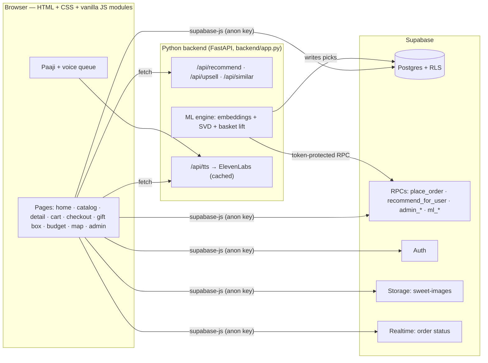

# 🪔 Mithai Mitra — *Har mann ki mithai, ek sujhaav door*

A festive mithai shop for **Muzaffarnagar** with a talking Punjabi halwai mascot, **Paaji**,
a free local machine-learning recommendation engine, and a shop designed around one idea:

> **"Ek banda ek cheez kharidne aaya tha… teen le gaya."**
> *(Someone came in for one thing and left with three.)*

---

## ✨ What makes it different

| Feature | What it does |
|---|---|
| 🧔🏽 **Talking Paaji** | Original animated SVG halwai (idle, wave, talk, point, think, celebrate, bhangra). Every line shows in a speech bubble **and** is spoken in a human voice (ElevenLabs "George", cached), with a free browser-voice fallback. He never talks over himself. |
| ✍️ **Original shayari** | 100 original shayari (Devanagari + Hinglish + English). Paaji recites the one for whatever you add. |
| 🎯 **"Ye bhi le jao, poore Muzaffarnagar mein nayi hai!"** | After every add, Paaji points at a perfect next sweet (new arrivals first) with a one-tap add. |
| 🍬 **Mix & Save** | 3 different sweets = 5% off, 5+ = 10% off — applied **on the server**. Live progress bar + Paaji nudges. |
| 🍬🍬🍬 **Trio bar** | After an add, a slim bar offers two perfect partners: *"Add both · 5% off unlocked"*. |
| ✨ **Free taste** | Orders with 3+ kinds get a free piece of a new arrival — introduces new sweets. |
| 🔥 **Honest social proof** | "14 orders this month" from real orders only. Never invented. |
| 🎁 **Gift Box Builder** | 4/9/16 pieces, tap or drag sweets in, "Paaji, bharo!" fills empty slots, ribbon + message card. Server-priced. |
| 💰 **Budget Mode** | "₹500 for 10 guests" → the best mix of hand-out-able sweets within budget. |
| 🗺️ **Mithai World Map** | Hex-tile maps of India and the world; tap a region to taste it. |
| 🧠 **Real ML** | Sentence-transformer embeddings + collaborative filtering (SVD) + basket lift, every pick explained ("Because you loved Rasgulla"). |
| 📝 **Taste Quiz** | 5 playful questions after sign-up; Paaji reacts to each answer. |
| 😊 **Mood picker** | Celebrating / Feeling light / Guests coming / Late-night craving re-ranks the home page. |
| 🎙️ **Voice search & commands** | "Paaji, do kilo kaju katli daal do" → added to cart. |
| 🪔 **Deepawali everything** | Live countdown to Lakshmi Puja (8 Nov 2026, 5:30 PM), Deepawali Night theme (auto near Deepawali evenings), toran, diya cursor trail, fireworks on order. |
| 🛠️ **Admin panel** | Dashboard, live orders, inventory & stock per weight, catalog editor with photo upload, **CSV import**, customers & their taste choices, Paaji lines & shayari editor, one-click model retraining. |

Plus: 242 sweets (174 Indian, 68 world) with real photos (Wikimedia Commons, credited), Hindi/English
toggle, guest cart merged on login, live order tracking (Supabase Realtime), "Your usual?" one-tap
reorder, favourites, sugar-free/vegan/Jain/gluten-free filters, reduced-motion support, mobile-first.

---

## 🎁 Feature Pack 2 — ten things no other mithai shop app does

| # | Feature | Where | What it does |
|---|---|---|---|
| 1 | **Kal Kitna Banana Hai?** owner dashboard | `#/owner` (admin) | Predicts tomorrow's kg per sweet (weekday history × trend × festival × weather + pre-orders), says *how much to make* with plain-word reasons, accuracy chart, waste tracker, kitchen print view, live controls. |
| 2 | **Deepawali Scratch Card** | order success screen | Canvas scratch (touch + mouse, "Tap to reveal" for keyboard). Prize chosen **in Postgres** at order time from owner-weighted prizes within a daily budget; revealed only when scratched; becomes a coupon in *Mere Coupons*. |
| 3 | **Mithai + Namkeen combos** | sweet page, cart, home | 42 namkeen with photos, owner pairing rules + bought-together + your spice taste (`suggest_combos`). **Jodi Boxes** get an automatic combo discount at checkout. |
| 4 | **Festival pre-orders** | `#/festivals` | 17 festivals for 12 months (lunar dates flagged *to be confirmed*), countdowns, reminders, slot booking with capacity locked inside `place_order`, cancel before cutoff. |
| 5 | **Aaj ka Taaza** | cards, home row, "Sirf taaza" filter, sweet page | Owner logs a fresh batch in seconds; every open phone shows "🔥 Aaj ka Taaza · Bana: 2 ghante pehle" instantly (Realtime). |
| 6 | **Weather & time-aware Paaji** | home banner | Free Open-Meteo weather (no key), city picker or "use my location" (never required), time of day, festival eve. Owner-editable rules. Demo: `?demo=cold|hot|rainy`, `?demo=off`. |
| 7 | **Last-hour deals** | home strip, cards, catalog filter | Short-shelf stock gets 10% → 20% → 30% off as closing nears, plus owner manual deals with a kg limit. Prices re-checked at order time; if a deal ended, checkout shows the new total first. |
| 8 | **Rishtedaar Gift Planner** | `#/gift-planner` | One budget, many relatives: preferences (sugar-free, nut allergy, Jain, no milk, likes), importance, household size → Paaji builds a box each with reasons, swaps, gift-card shayari, one order. Dietary rules enforced again in Postgres. |
| 9 | **Bhooli Hui Mithai** | `#/bhooli-mithai` | Describe a sweet you can't name ("gol si, chashni mein doobi…") → Hinglish dictionary → `identify_sweet` (traits + `pg_trgm` + full-text) → Akinator-style questions → big reveal. **20/20** on the test set ([docs](docs/bhooli-mithai-tests.md)). |
| 10 | **Garam Jalebi Alert** | owner dashboard → everyone | "Garam batch aa raha hai" → live banner with countdown and *kitna bacha*, "Mere liye rakh lo" reservation (oversell-proof), optional Web Push via an Edge Function, quiet hours + daily cap. |

**How they connect:** pre-orders, fresh batches, weather and festivals feed the prediction · slow movers → "Create last-hour deal" ·
hot batches create fresh batches · combos appear in the cart, sweet pages and the gift planner · scratch coupons work on regular,
pre-order and gift-plan orders · a Bhooli Hui Mithai result can go into the gift plan in one tap.

### Feature Pack 2 setup
1. **Database:** run `supabase/migrations/002_feature_pack.sql` (idempotent), then the *Feature Pack 2* part at the end of
   `supabase/seed.sql` (also in `supabase/seed_feature_pack.sql`). Realtime is enabled for `batches`, `hot_batches`, `deals`,
   `sweet_variants` and `preorder_slots` by the migration.
2. **Owner settings:** Admin → **⚙️ Feature settings** edits every number (deal window, prize budget, weights, festival dates…).
   The same defaults are in `js/feature-config.js`.
3. **Web Push (optional):** generate keys with `npx web-push generate-vapid-keys`, put the public key in `js/push.js`
   and `supabase/functions/hot-alert-push/index.ts`, store the private key once in SQL
   (`insert into private.push_keys (name, value) values ('vapid_private', '…')`), and deploy the function:
   `supabase functions deploy hot-alert-push`. Without it, alerts still arrive in-app through Realtime.
4. **Tests:** `node tests/bhooli-tests.mjs --write` re-runs the Bhooli Hui Mithai descriptions against the live database.

### 📈 How "Kal Kitna Banana Hai?" predicts (for judges)
For each sweet: **base** = average kg sold on the same weekday over the last 8 weeks (falls back to the daily average, then the
category average) · **trend** = last 7 days ÷ previous 7 days, kept between 0.7× and 1.3× · **festival** = the festival calendar's
multiplier when one is within its booking window (full strength 0–2 days before) · **weather** = tomorrow's Open-Meteo forecast
(cold → halwa up, hot → kulfi up), kept between 0.85× and 1.15× · **pre-orders** booked for that day are added on top.
`predicted = base × trend × festival × weather + pre-orders`, range = ± one standard deviation, and
`make = predicted − counter stock + safety buffer`, rounded up to 0.5 kg. Every multiplier that isn't ~1 becomes a reason
("Dussehra is tomorrow", "Saturday is usually 40% busier", "12 kg pre-ordered"). The chart compares each past day with the
prediction made from the 4 weeks before it.

### 🕵️ How Bhooli Hui Mithai matches (for judges)
Every sweet has describable traits (shape, colours, syrup, filling, fried, served warm/cold, base, flavours, aliases).
`js/describe-dictionary.js` turns everyday words — *gol, chashni, naram, tali hui, kesar, peeli, Kolkata, shaadi* and common
misspellings — into traits. `identify_sweet()` in Postgres adds points for each match (syrup and base count most), takes points
away for contradictions (described crunchy but the sweet is soft), adds region/occasion matches, fuzzy name matching with
`pg_trgm` on the words the dictionary didn't explain ("woh *chum* wali") and full-text search on stories. If the top two are
close, `next_question()` picks the yes/no question that best separates them (max 3).

## 🏗️ Architecture



- **The shop works even when Python is off**: the ML job saves its results to Supabase
  (`sweet_similar`, `user_recos`), and SQL functions provide a full fallback.
- **No service-role key in the app.** The ML engine authenticates with a random `ML_TOKEN`; only its
  SHA-256 hash lives in a private schema. Prices, discounts and stock are always computed in Postgres.

```
swaad-sujhav/
├── index.html              # app shell (entry screen, header, drawer, Paaji, icon sprite)
├── css/                    # tokens, base, components, pages, paaji, festive
├── js/                     # main (router), catalog, cart, deals, recommend, paaji, voice, lines, festive, …
│   └── pages/              # home, catalog, detail, profile, checkout, order, giftbox, budget, worldmap, admin
├── backend/                # FastAPI app + ML engine + TTS proxy
├── seed/                   # catalog data, shayari, seed generator (photos via Wikimedia API)
├── supabase/
│   ├── schema.sql          # tables, RLS, triggers, all functions
│   ├── seed.sql            # generated: 242 sweets, variants+stock, shayari, demo customers & orders
│   └── templates/          # CSV templates for the admin importer
└── docs/                   # SPEC_ADDENDUM.md, voice samples
```

---

## 🚀 Setup

1. **Supabase**: create a project, then in the SQL editor run, in order:
   1. `supabase/schema.sql`
   2. `supabase/seed.sql` (or the files in `supabase/seed_parts/` one by one)
2. **Frontend config**: copy `js/config.example.js` → `js/config.js` and fill in the project URL and the
   **anon/publishable** key (Project Settings → API). Never put the service-role key here.
3. **Backend** (recommendations + Paaji's studio voice):
   ```bash
   cd backend
   python -m venv .venv
   .venv\Scripts\pip install -r requirements.txt      # macOS/Linux: .venv/bin/pip
   copy .env.example .env                              # then fill it in
   .venv\Scripts\python app.py                          # → http://localhost:8130
   ```
   In `.env`: `SUPABASE_URL`, `SUPABASE_ANON_KEY`, a random `ML_TOKEN`
   (e.g. `python -c "import secrets;print(secrets.token_urlsafe(32))"`), and optionally
   `ELEVENLABS_API_KEY` + `ELEVENLABS_VOICE_ID`. Then register the token's hash once in the SQL editor:
   ```sql
   insert into private.app_secrets (name, sha256_hex)
   values ('ml_token', encode(extensions.digest('<your ML_TOKEN>', 'sha256'), 'hex'))
   on conflict (name) do update set sha256_hex = excluded.sha256_hex, updated_at = now();
   ```
   The model trains on startup and every `RETRAIN_EVERY_MINUTES` (default 60).
4. **Frontend-only hosting** (Netlify/Vercel): deploy the folder as a static site (exclude `backend/`,
   `seed/`, `supabase/seed*`), and set `API_BASE` in `js/config.js` to your backend URL. The shop still
   works without the backend (SQL fallbacks + saved ML picks + browser voice).

> ⚠️ Only `css/`, `js/`, `assets/`, `index.html` and `supabase/templates/` are public. `backend/app.py`
> serves exactly those — never the project root (it contains `backend/.env`).

### Make yourself an admin
Sign up in the app, then in the SQL editor:
```sql
update public.profiles set is_admin = true
where id = (select id from auth.users where email = 'you@example.com');
```
Open **Profile → 🛠️ Admin panel** (or `#/admin`). Admins can promote others from the Customers tab.

### Demo accounts (test data only)
- **Customer:** `priya.demo@swaadsujhav.test` — has a ready 5-person Rishtedaar gift plan (₹4,000) and coupon `SSDEMO10`.
  Others: `rohan.demo@`, `meera.demo@` (sugar-free), `arjun.demo@` (world desserts), `simran.demo@`, `kavya.demo@` — all `@swaadsujhav.test`.
- **Owner:** your own account with `is_admin = true` (see above). `admin@swaadsujhav.test` exists as a test login; make it an
  owner only on a private demo copy (`update public.profiles set is_admin = true where id = (select id from auth.users where email = 'admin@swaadsujhav.test')`)
  — never on the public shop, because this password is in the README.
- Password for the test accounts: `SwaadDemo#2026` (defined in `seed/build_seed.py`). Delete or change them before going live.

---

## 🧠 How recommendations work (in simple words)

Paaji looks at every sweet in four ways and mixes the scores:

1. **What it *is*** — a small free AI model (sentence-transformers) reads each sweet's name, story,
   ingredients and region and turns it into numbers, so it knows *Rasmalai* is close to *Rasgulla* and
   *Baklava* is close to *Turkish Delight*. ("More dishes like this")
2. **Who buys it** — if people who love *Tiramisu* also love *Kunafa*, you might too
   (collaborative filtering with SVD).
3. **What goes together** — sweets that land in the same order ("Goes great with").
4. **You** — your taste-quiz answers, favourites and past orders.

```
score = 0.35 × your taste      + 0.20 × bought together / people like you
      + 0.10 × popularity      + 0.10 × new arrival   + 0.08 × occasion
      + 0.07 × freshness (Aaj ka Taaza)  + 0.06 × weather/time context  + 0.04 × last-hour deal
```
The first five come from the ML server / SQL; the browser adds the three live signals that change during the day
(`js/recommend.js`), and the winning signal becomes the reason on the card ("Kyunki bahar 12°C hai", "Aaj ka taaza").
Weights live in one place: `app_settings.reco_weights` (owner-editable) mirrored in `js/feature-config.js` and `ml.py`.

Rules on top: never suggest what's already in your cart, **always respect diet choices** (a sugar-free
customer only ever sees sugar-free sweets), keep variety (max 2 of a kind in a row), and explain every
pick.

---

## 🧪 Useful checks

- `GET /api/health` — model status, last training run, voice status.
- Admin → Dashboard → **Retrain now**.
- Restore order statuses after a bulk cancel (backup kept in `private.order_status_backup`):
  ```sql
  update public.orders o set status = b.status from private.order_status_backup b where b.order_id = o.id;
  ```

## 📜 Credits
- Sweet photos: Wikimedia Commons contributors (licence + author shown on each sweet's page).
- Paaji, all artwork, dialogue and shayari: original, written for Mithai Mitra.
- Voice: ElevenLabs (optional) / Web Speech API. Embeddings: `all-MiniLM-L6-v2`.
